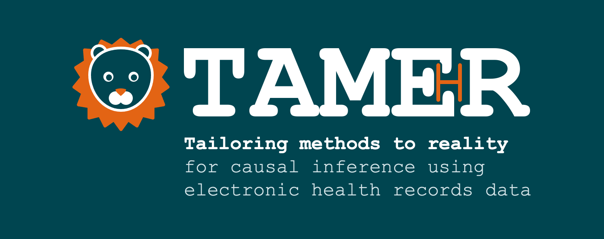

{width=100% fig-alt="TAMER: Tailoring methods to reality for causal inference using electronic health records data. A NIHR-funded project."}

## About the project

Linked electronic health records (EHR) are a valuable resource for generating evidence about the effects of treatments. Their scale and detail offer the potential to investigate the effects of complex treatment strategies. 

However, estimating causal effects from EHR data requires careful consideration. TAMER aims to extend causal inference methods for time-to-event outcomes so that researchers can investigate more complex treatment strategies while addressing two important challenges: **large sample sizes** and **irregular monitoring of individuals**.

Find out more below!

  <a href="news.qmd"><strong>Latest news</strong>Updates, events, and announcements.</a>
  <a href="team.qmd"><strong>Meet the team</strong>Researchers and steering group</a>

[<i class="bi bi-github"></i> TAMER-EHR on GitHub](https://github.com/TAMER-EHR){.github-link}

::: {.funder-statement}

{.nihr-logo fig-alt="NIHR logo"}

This project is funded by the NIHR. The views expressed are those of the author(s) and not necessarily those of the NIHR or the Department of Health and Social Care.

::: {.contact-block}
For questions about the project contact: **ruth.keogh@lshtm.ac.uk**

London School of Hygiene & Tropical Medicine, Keppel St, London, WC1E 7HT
:::

:::
